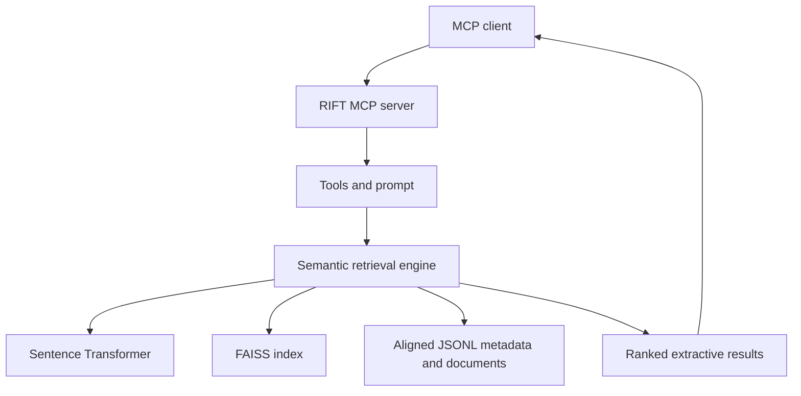

# RIFT

## Red-team Intelligence & Fusion Toolkit

**MCP-powered offensive security intelligence engine using local semantic
retrieval, FAISS, and RAG.**

[](https://github.com/Sabriigsxr/RIFT/actions/workflows/ci.yml)
[](https://github.com/Sabriigsxr/RIFT)
[](https://github.com/Sabriigsxr/RIFT)

🇪🇬 **Proudly built in Egypt** by **Ahmed Sabry ([Sabriigsxr](https://github.com/Sabriigsxr))**,
Cyber Security Researcher.

RIFT is a local-first Model Context Protocol (MCP) server for authorized
penetration testing, detection engineering, DFIR, cybersecurity education,
and security research. It retrieves existing knowledge-base entries with
Sentence Transformers and FAISS; it does not generate attack plans, execute
commands, or require a paid API.

> **Authorized use only.** Use RIFT only on systems and data you own or have
> explicit written permission to assess. Read
> [`docs/ETHICAL_USE.md`](docs/ETHICAL_USE.md) and [`WARNING.txt`](WARNING.txt).

## Why RIFT

- **Local-first:** query-time retrieval works without a cloud service after
  the model and index are installed.
- **MCP-native:** stdio is the default for desktop and coding clients, with
  streamable HTTP available on localhost.
- **Verified at load:** the FAISS index, metadata, and documents are
  alignment- and dimension-checked before RIFT answers a single query; the
  bundled index ships with a SHA-256 checksum.
- **Extractive and inspectable:** results include IDs, scores, metadata, and
  source Q&A rather than silently generated claims.

## Architecture



See [`docs/ARCHITECTURE.md`](docs/ARCHITECTURE.md) for the actual lifecycle
and [`docs/RETRIEVAL_ENGINE.md`](docs/RETRIEVAL_ENGINE.md) for validation and
scoring details.

## MCP capabilities

| Capability | Purpose |
|---|---|
| `search_offensive_scenarios` | JSON semantic search with scores and metadata |
| `ask_offensive_scenario` | Human-readable extractive rendering |
| `index_stats` | Vector, document, dimension, model, and path information |
| `offensive_scenario_brief` | Prompt template for a grounded research briefing |

Tools only — no MCP resources — by design. Tool names are stable for
client configurations.

## Installation

```bash
git clone https://github.com/Sabriigsxr/RIFT.git
cd RIFT
python3 -m venv .venv
.venv/bin/pip install -e .
bash scripts/restore_index.sh
```

The bundled archive is verified by SHA-256 and restored to the git-ignored
`index/` directory. It contains 23,737 document and metadata records. RIFT
does not automatically regenerate or replace it.
See [`docs/INSTALLATION.md`](docs/INSTALLATION.md) and
[`docs/DATASET.md`](docs/DATASET.md).

## Run

stdio is the default transport:

```bash
.venv/bin/rift
```

For a local streamable HTTP endpoint:

```bash
.venv/bin/rift --transport http --host 127.0.0.1 --port 8787
# endpoint: http://127.0.0.1:8787/mcp
```

The first model load may need network access to populate the local model
cache. Later, use `HF_HUB_OFFLINE=1 TRANSFORMERS_OFFLINE=1` for offline
operation.

## Configuration

Configuration variables are `RIFT_INDEX_DIR` and `RIFT_MODEL`.

```bash
export RIFT_INDEX_DIR="$PWD/index"
export RIFT_MODEL="sentence-transformers/all-MiniLM-L6-v2"
```

The model must match the index embedding dimension. Configuration and network
exposure guidance are in [`docs/CONFIGURATION.md`](docs/CONFIGURATION.md).

## Client configuration

### Claude Desktop

```json
{
  "mcpServers": {
    "rift": {
      "command": "/absolute/path/to/RIFT/.venv/bin/python",
      "args": ["-m", "rift_mcp"],
      "env": {
        "RIFT_INDEX_DIR": "/absolute/path/to/RIFT/index"
      }
    }
  }
}
```

### OpenCode

```jsonc
{
  "mcp": {
    "rift": {
      "type": "local",
      "enabled": true,
      "command": ["/absolute/path/to/RIFT/.venv/bin/python", "-m", "rift_mcp"],
      "environment": {
        "RIFT_INDEX_DIR": "/absolute/path/to/RIFT/index"
      }
    }
  }
}
```

No additional client is claimed without a verified integration.

## Rebuild an index

Only build from a dataset you are authorized to use:

```bash
.venv/bin/python scripts/build_index.py \
  --documents /path/to/documents.jsonl \
  --out /path/to/new-index
```

The builder validates JSONL records, uses the selected embedding model, and
refuses to overwrite a populated directory unless `--force` is supplied.
Never mix an index with JSONL files from another build.

## Security and ethical use

RIFT is not an autonomous exploitation framework. It has no shell execution
or arbitrary target access. HTTP is unauthenticated and binds to localhost by
default; do not expose it publicly without access controls and TLS. Retrieved
text is untrusted reference material and must be independently reviewed.

Read [`docs/SECURITY.md`](docs/SECURITY.md) and
[`docs/ETHICAL_USE.md`](docs/ETHICAL_USE.md).

## Development

```bash
.venv/bin/pip install -e '.[dev]'
.venv/bin/pytest
.venv/bin/ruff check .
python -m compileall -q rift_mcp scripts tests
```

See [`docs/DEVELOPMENT.md`](docs/DEVELOPMENT.md) and
[`CONTRIBUTING.md`](CONTRIBUTING.md). Release preparation details are in
[`docs/RELEASE_NOTES.md`](docs/RELEASE_NOTES.md).

## Roadmap

- Reproducible, signed index builds with documented dataset provenance.
- Broader integrity and compatibility coverage across MCP SDK major versions.
- Optional retrieval evaluation sets for recall and ranking regression checks.
- Maintainer-reviewed dataset governance and contribution workflow.

## Made in Egypt — Developer

**Ahmed Sabry ([Sabriigsxr](https://github.com/Sabriigsxr))** — Cyber Security Researcher

RIFT is an Egyptian-built open-source security research tool, made with 🇪🇬 for the
authorized offensive-security and detection-engineering community. Every retrieval,
document, and test in this toolkit was engineered locally to demonstrate that world-class
security tooling can come from Egypt.

## Status, license, and acknowledgments

RIFT is at its initial prepared release (`2.0.0`); release notes are in
[`docs/RELEASE_NOTES.md`](docs/RELEASE_NOTES.md). No license has been chosen
yet, and none is inserted without ownership and redistribution review. Treat
the project and bundled data as all rights reserved until licensing is
resolved.

RIFT builds on the Model Context Protocol, Sentence Transformers, FAISS, and
NumPy. See [`CHANGELOG.md`](CHANGELOG.md).
