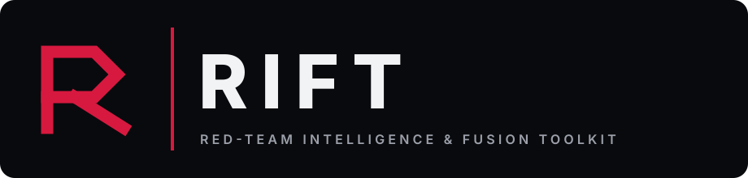

# RIFT

<div align="center">



**MCP-Powered Offensive Security Intelligence Engine**
**Local Offensive Security Knowledge Engine**

[](https://github.com/Sabriigsxr/RIFT/actions/workflows/ci.yml)
[](https://github.com/Sabriigsxr/RIFT)
[](https://github.com/Sabriigsxr/RIFT)

🇪🇬 **Proudly built in Egypt** by **Ahmed Sabry ([Sabriigsxr](https://github.com/Sabriigsxr))**, Cyber Security Researcher.

</div>

---

> **Authorized use only.** Use RIFT only on systems and data you own or are
> explicitly authorized to assess. See [`docs/ETHICAL_USE.md`](docs/ETHICAL_USE.md)
> and [`WARNING.txt`](WARNING.txt).

RIFT is a local-first **Model Context Protocol (MCP)** server that gives AI
assistants instant, inspectable access to a curated offensive-security
knowledge base — detection engineering, DFIR, and authorized pentest
techniques mapped from a Q&A corpus of **23,737 entries**. Retrieval is
semantic (Sentence Transformers + FAISS), exact (flat inner-product scan),
and **extractive**: RIFT returns what the knowledge base contains, never an
invented plan. No API keys, no cloud services, no telemetry.

## The problem RIFT solves

Security teams routinely have to answer the same questions over and over —
*"which Event IDs cover this technique?"*, *"what does the literature say
about detecting pass-the-hash?"* — while the answers already exist in a
knowledge base that nobody can query mid-incident. Searching 23,737 entries
by hand is too slow; asking an LLM from memory risks confabulation.

RIFT closes that gap: the knowledge base becomes a tool your AI client can
query directly, with citable `doc_id`s, zero network dependency at query
time, and every answer grounded in source material.

## Why RIFT

- **Local-first:** query-time retrieval works with no network once the model
  and index are present.
- **MCP-native:** stdio by default for OpenCode, Claude Desktop, and other
  MCP clients; streamable HTTP on localhost available.
- **Exact & verified:** FAISS `IndexFlatIP` over normalized vectors;
  load-time validation of index, metadata, documents, counts, IDs, and
  embedding dimensions; SHA-256-verified bundled index.
- **Extractive & inspectable:** answers carry scores, metadata, and the
  stored Q&A — no silent generation.
- **Egyptian-built, open-source-minded:** proudly made in Egypt, documented
  for real-world professional use.

## Capabilities (implemented)

| Tool / prompt | What it does |
|---|---|
| `search_offensive_scenarios(query, top_k=5, threshold=0.25)` | Cosine-similarity semantic search; returns JSON with doc_ids, scores, tags, CVEs, tools |
| `ask_offensive_scenario(question, top_k=5, threshold=0.25)` | Same retrieval, rendered as readable, citable text |
| `index_stats()` | Reports vectors (23,737), dimensions (384), `IndexFlatIP`, model, and path |
| `offensive_scenario_brief(topic)` | MCP prompt template for an ATT&CK-aligned briefing grounded in retrieved entries |

Tools only — no MCP resources, no shell/command tools, by design. Full
contracts: [`docs/MCP_INTEGRATION.md`](docs/MCP_INTEGRATION.md).

## How it works

```text
documents.jsonl (authorized Q&A)
  → Sentence Transformer embeds question+answer (384 dims, normalized)
  → FAISS IndexFlatIP (exact inner product = cosine similarity)
  → aligned metadata.jsonl / documents.jsonl (1:1 by doc_id)
  → RIFT MCP server (stdio default, localhost HTTP optional)
  → your AI client
```

Full Mermaid diagrams: [`docs/diagrams/`](docs/diagrams/README.md) —
[system architecture](docs/diagrams/system-architecture.mmd),
[data ingestion](docs/diagrams/data-ingestion-flow.mmd),
[semantic search](docs/diagrams/semantic-search-flow.mmd),
[MCP request path](docs/diagrams/mcp-integration-flow.mmd),
[deployment](docs/diagrams/deployment-architecture.mmd).

Deeper explanations at three levels: [`docs/HOW_IT_WORKS.md`](docs/HOW_IT_WORKS.md).

## Quick start

```bash
git clone https://github.com/Sabriigsxr/RIFT.git
cd RIFT
python3 -m venv .venv
.venv/bin/pip install -e .
bash scripts/restore_index.sh    # SHA-256 verified, restores ./index/
.venv/bin/rift --version         # rift 2.0.0
```

First query needs the embedding model once (~80 MB, cached); after that,
offline operation works with `HF_HUB_OFFLINE=1 TRANSFORMERS_OFFLINE=1`.

See the full tutorial:
**[From Zero to Your First RIFT MCP Search](docs/GETTING_STARTED.md#from-zero-to-your-first-rift-mcp-search)**.

## Example (real captured output)

Query `kerberoasting detection` with `threshold=0.6`, `top_k=2`:

```json
{
  "query": "kerberoasting detection",
  "count": 2,
  "results": [
    {
      "doc_id": "cybersec-14323::q1172",
      "score": 0.7102,
      "question": "What techniques would you implement to detect Kerberoasting that occurs through compromised administrative accounts?"
    }
  ]
}
```

`ask_offensive_scenario("how do I detect Pass-the-Hash attacks?")` at the
default threshold returns relevance `0.495`, entry `cybersec-51393::q2128`
covering Event IDs 4624/4648/4672. Full transcripts:
[`docs/USAGE_EXAMPLES.md`](docs/USAGE_EXAMPLES.md) and
[`docs/demo/`](docs/demo/DEMO.md).

## Client setup

**Claude Desktop** (`claude_desktop_config.json`)

```json
{
  "mcpServers": {
    "rift": {
      "command": "/absolute/path/to/RIFT/.venv/bin/python",
      "args": ["-m", "rift_mcp"],
      "env": {
        "RIFT_INDEX_DIR": "/absolute/path/to/RIFT/index",
        "HF_HUB_OFFLINE": "1",
        "TRANSFORMERS_OFFLINE": "1"
      }
    }
  }
}
```

**OpenCode** (`opencode.jsonc`)

```jsonc
{
  "mcp": {
    "rift": {
      "type": "local",
      "command": ["/absolute/path/to/RIFT/.venv/bin/python", "-m", "rift_mcp"],
      "environment": {
        "RIFT_INDEX_DIR": "/absolute/path/to/RIFT/index",
        "HF_HUB_OFFLINE": "1",
        "TRANSFORMERS_OFFLINE": "1"
      }
    }
  }
}
```

Then ask your client: *"Use RIFT to find Kerberoasting detection guidance and
cite the doc_ids."*

## Configuration

| Variable | Purpose | Default |
|---|---|---|
| `RIFT_INDEX_DIR` | Path to the index directory (`faiss.index`, `documents.jsonl`, `metadata.jsonl`) | `./index` |
| `RIFT_MODEL` | Sentence Transformers model id | `sentence-transformers/all-MiniLM-L6-v2` |
| `HF_HUB_OFFLINE` | Force offline model resolution | unset |
| `TRANSFORMERS_OFFLINE` | Force offline transformers resolution | unset |

HTTP mode: `rift --transport http --host 127.0.0.1 --port 8787` →
`http://127.0.0.1:8787/mcp`.

## Security considerations

- Retrieval is extractive; RIFT cannot "act" — it advises with citable sources.
- **The HTTP transport has no authentication** — bind loopback, or put it
  behind an access-controlled boundary with TLS.
- Bundle integrity: SHA-256 checksum + traversal/type archive checks +
  load-time alignment validation. Never mix files from different index builds.
- Retrieved text is untrusted reference material: review before acting.
- Details: [`docs/SECURITY.md`](docs/SECURITY.md).

## Ethical use

RIFT is for authorized penetration testing, detection engineering, DFIR,
education, and research on systems you own or are explicitly permitted to
assess. It is not an attack tool and cannot be used to attack anything. See
[`docs/ETHICAL_USE.md`](docs/ETHICAL_USE.md) and [`WARNING.txt`](WARNING.txt).

## Screenshots

Real captures are pending — the build environment had no GUI screenshot
tooling and fabricated terminal images are not acceptable. See the capture
checklist: [`assets/screenshots/CAPTURE_CHECKLIST.md`](assets/screenshots/CAPTURE_CHECKLIST.md).
Until then, visuals are the brand kit ([`assets/branding/`](assets/branding/)) and the
Mermaid diagrams.

## Contributing

Read [`CONTRIBUTING.md`](CONTRIBUTING.md) and
[`docs/CONTRIBUTING.md`](docs/CONTRIBUTING.md). Keep local-first scope, do not
regenerate the bundled index, and never add command-execution tools.

## Roadmap

See [`docs/ROADMAP.md`](docs/ROADMAP.md) — Phase 1 (stability) through
Phase 4 (ecosystem). Nothing on the roadmap is implemented until it ships.

## Known limitations

- Retrieval is dense semantic search only — no hybrid keyword/vector ranking.
- Extractive answers can be incomplete; always review source entries.
- The HTTP endpoint lacks built-in auth.
- No streaming responses; results are returned complete.
- Requires the embedding model to be cached locally on first use (~80 MB).
- No license selected yet — bundled data rights not yet adjudicated (treat as
  all rights reserved).

## Status & release

Release notes: [`docs/RELEASE_NOTES.md`](docs/RELEASE_NOTES.md). Changelog:
[`CHANGELOG.md`](CHANGELOG.md). RIFT 2.0.0.

---

**Made in Egypt 🇪🇬 by Ahmed Sabry ([Sabriigsxr](https://github.com/Sabriigsxr))** — Cyber Security Researcher
