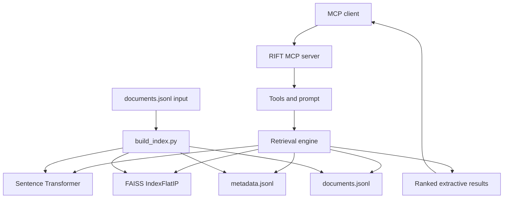

# Architecture

Index construction embeds `question` plus `answer` with normalized
Sentence-Transformers vectors, writes an inner-product FAISS index, and keeps
the document and metadata lines in the same order. Query handling embeds one
non-empty query, searches up to 20 vectors, applies the configured threshold,
and maps each vector position through metadata to a document ID.

The server returns either structured JSON (`search_offensive_scenarios`) or a
human-readable extractive rendering (`ask_offensive_scenario`). It does not
generate attack plans, execute commands, or write query-time files. Missing
files, malformed JSONL, alignment errors, and dimension mismatches are
reported as explicit startup errors.
