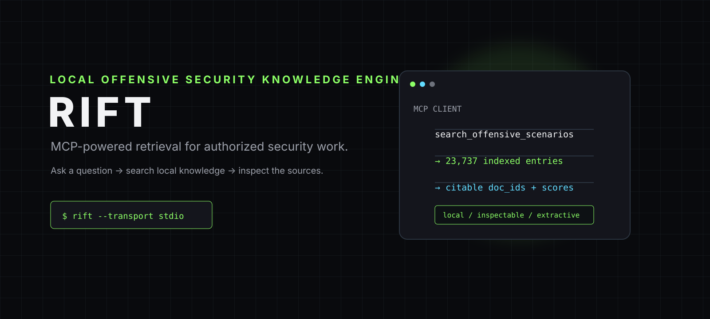
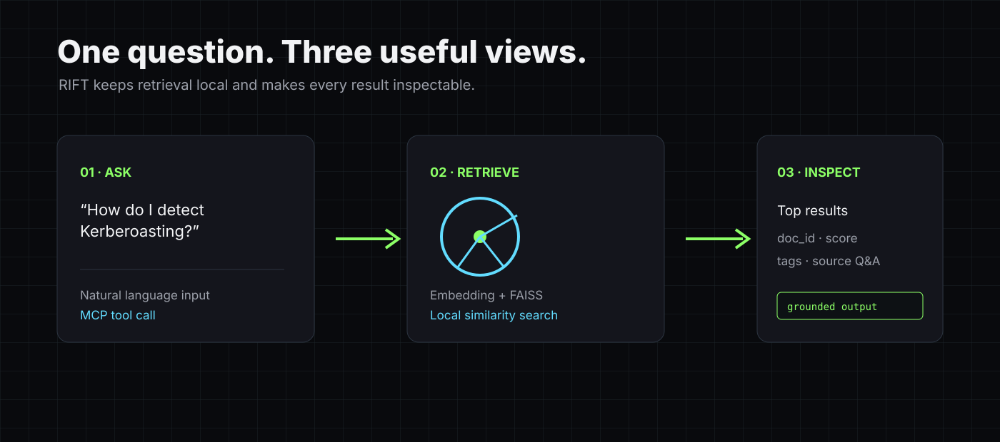
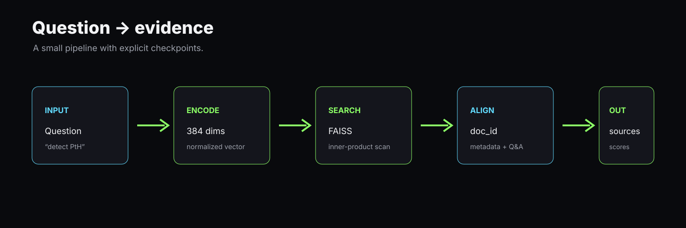
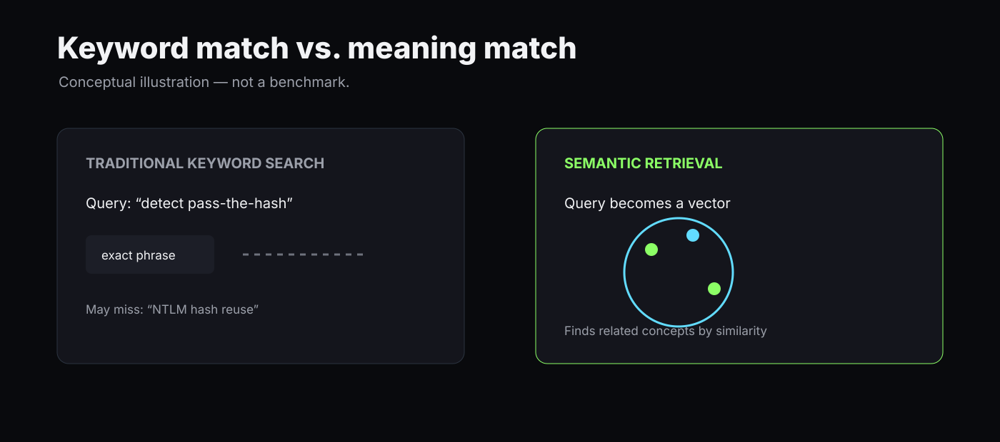
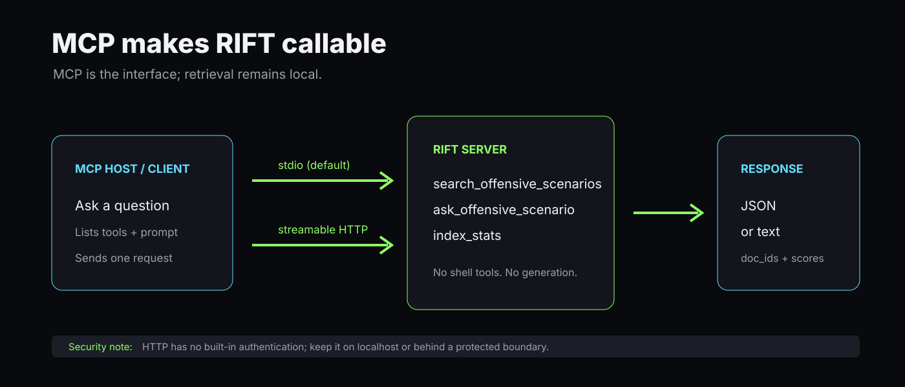
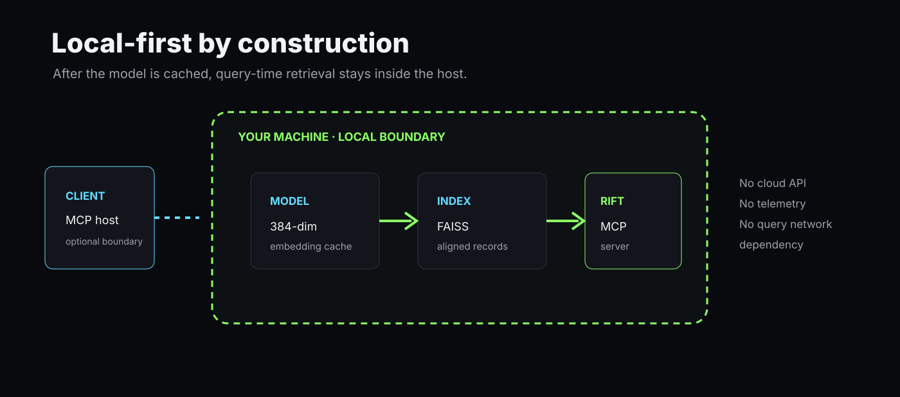
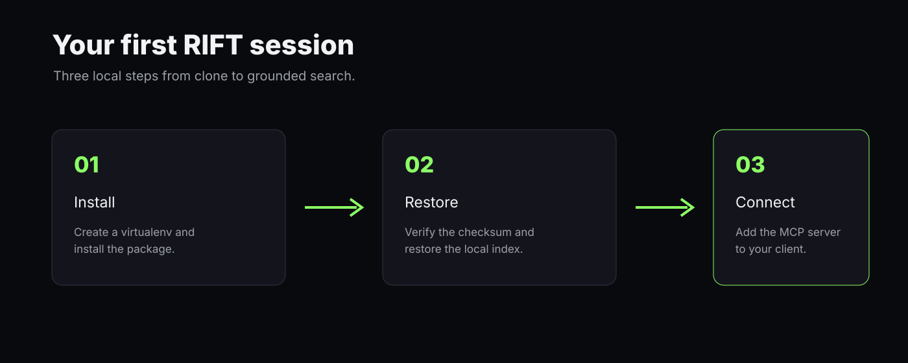

# RIFT product overview

Short, visual-first presentation. Each slide has one dominant visual and a
single message.

## Slide 1 — Identity

**RIFT — Local Offensive Security Knowledge Engine**

## Slide 2 — The problem

Security knowledge is valuable only when a team can find and inspect it during
real work.

## Slide 3 — The solution

RIFT gives an MCP client a local, citable retrieval layer over the existing
knowledge base.

## Slide 4 — How it works

Question → embedding → FAISS similarity search → aligned source records.

## Slide 5 — Semantic search

Related wording can match by meaning. The illustration is conceptual, not a
benchmark.

## Slide 6 — MCP integration

stdio is the default transport; streamable HTTP is optional and should remain
protected.

## Slide 7 — Local-first architecture

Model, index, records, and retrieval stay on the host after model caching.

## Slide 8 — Real product screenshots

Runtime screenshots are pending in this environment because no terminal
screenshot capture tool is installed. See the implementation report and
`assets/screenshots/CAPTURE_CHECKLIST.md`; no mockups are labeled as real.

## Slide 9 — Example workflow

Install → restore the verified index → connect an MCP client → inspect sources.

## Slide 10 — Capabilities and limitations

Implemented: semantic search, extractive answers, index stats, and one prompt.
Not implemented: shell tools, command execution, autonomous exploitation,
streaming responses, or HTTP authentication.

## Slide 11 — Roadmap

See the maintained [roadmap](../ROADMAP.md). Roadmap items are not presented
as shipped capabilities.

## Slide 12 — Getting started

Follow [FIRST_SEARCH_TUTORIAL.md](../visual-guide/FIRST_SEARCH_TUTORIAL.md),
then read [ETHICAL_USE.md](../ETHICAL_USE.md) and
[SECURITY.md](../SECURITY.md).
