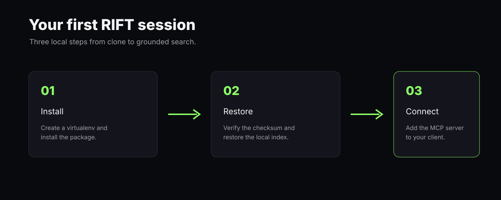

# First search: a visual tutorial



## 1. Install

```bash
python3 -m venv .venv
.venv/bin/pip install -e .
```

## 2. Restore the verified local index

```bash
bash scripts/restore_index.sh
.venv/bin/rift --version
```

The restore script verifies `data/index.tar.gz` before extracting the
FAISS/index records into the ignored `index/` directory.

## 3. Connect an MCP client

Use the [client configuration examples](../../examples/) and ask:

> Use RIFT to find Kerberoasting detection guidance and cite the `doc_id`s.

The expected result is a structured or extractive response grounded in stored
entries. See the [real demo transcript](../demo/SEARCH_EXAMPLE.md) for verified
values.
