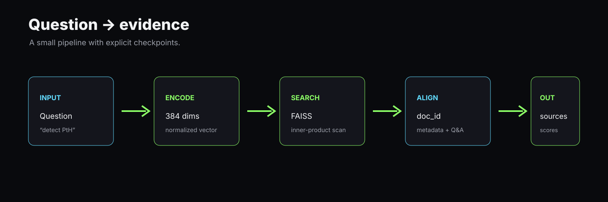

# How RIFT works

RIFT is a retrieval pipeline, not an autonomous exploitation framework.

1. **User question** — a client sends a topic such as “detect pass-the-hash”.
2. **MCP tool call** — the request uses `search_offensive_scenarios` or
   `ask_offensive_scenario`.
3. **RIFT engine** — validates inputs and loads the lazy engine singleton.
4. **Query embedding** — the local Sentence Transformer produces a normalized
   384-dimensional vector.
5. **FAISS search** — `IndexFlatIP` performs an exact inner-product scan.
6. **Knowledge retrieval** — aligned metadata and document records are joined
   by `doc_id`.
7. **Extractive output** — JSON or readable text returns scores and stored
   source material to the MCP client.

**Deeper reference:** [Architecture](../ARCHITECTURE.md) ·
[Retrieval engine](../RETRIEVAL_ENGINE.md)
