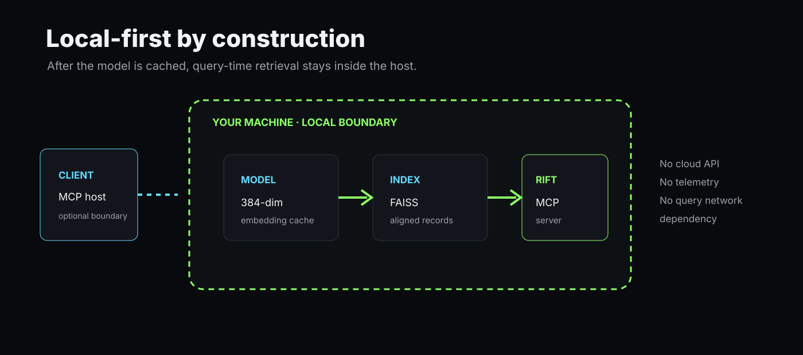

# Hybrid AI concept (external architecture)

This page describes an **optional architecture concept**, not a built-in RIFT
feature. A cloud planner could decide which question to ask, while a local
executor could perform an approved workflow. RIFT would remain the evidence
retrieval layer between them.

| Component | Responsibility | RIFT status |
|---|---|---|
| Planner | Decides what information to request | External concept |
| RIFT | Retrieves and cites local knowledge | Implemented |
| Executor | Performs explicitly authorized local operations | External concept |

RIFT does not execute commands, access targets, or make autonomous decisions.
Any integration must preserve authorization, review, logging, and the
network-boundary controls described in [SECURITY.md](../SECURITY.md).
