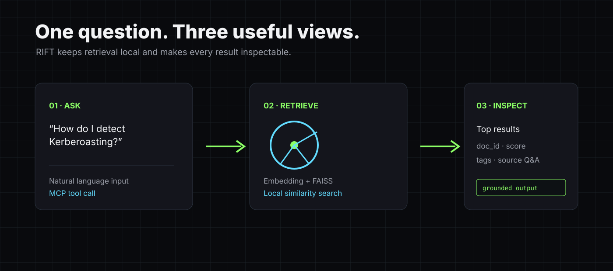
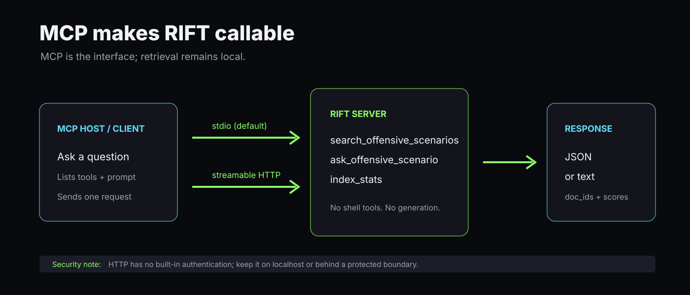
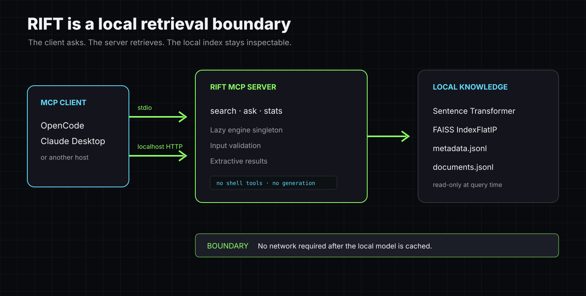

# RIFT visual learning path

## Beginner — understand RIFT

**Example:** ask “detect Kerberoasting” and inspect the returned `doc_id`.
Start with [What is RIFT?](WHAT_IS_RIFT.md),
[MCP explained](MCP_EXPLAINED.md), and the
[first-search tutorial](FIRST_SEARCH_TUTORIAL.md).

## Intermediate — use RIFT

**Example:** compare `search_offensive_scenarios` JSON with
`ask_offensive_scenario` text, then connect a client using
[MCP_INTEGRATION.md](../MCP_INTEGRATION.md). Learn the parameters in
[USAGE_EXAMPLES.md](../USAGE_EXAMPLES.md).

## Advanced — understand the architecture

**Example:** trace a query from the 384-dimensional embedding through
`IndexFlatIP` to aligned metadata. Continue with
[HOW_IT_WORKS.md](../HOW_IT_WORKS.md),
[RETRIEVAL_ENGINE.md](../RETRIEVAL_ENGINE.md), and
[CONFIGURATION.md](../CONFIGURATION.md).
