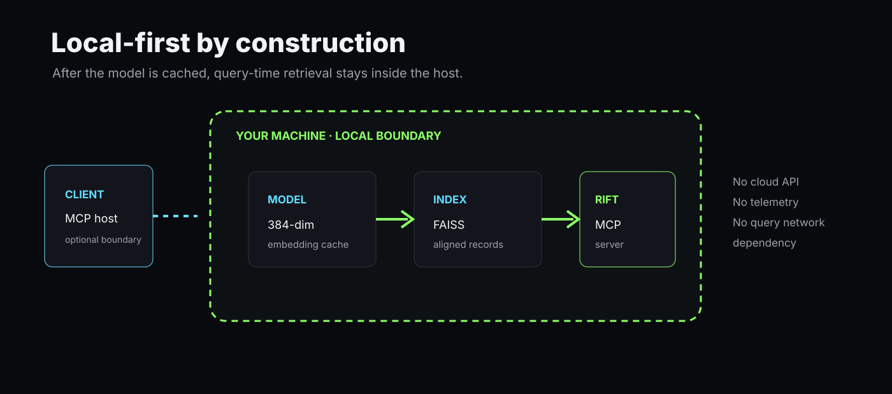

# Local-first architecture

The local boundary contains the embedding model, FAISS index, aligned JSONL
records, and RIFT MCP server. Once the model is present locally, a query does
not require a cloud API, telemetry, or a network call.

The client remains a separate boundary: it can be OpenCode, Claude Desktop,
or another MCP-capable host. An optional external model may interpret returned
evidence, but RIFT itself only retrieves and formats stored entries.

**Reference:** [Configuration](../CONFIGURATION.md) ·
[Security](../SECURITY.md) · [Dataset](../DATASET.md)
