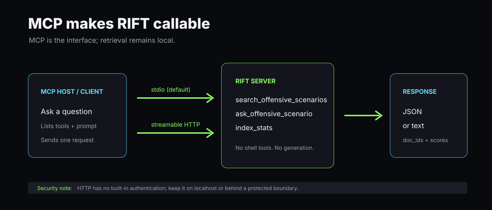

# MCP explained through RIFT

MCP is the contract that lets an AI host discover and call RIFT. The host
starts RIFT over **stdio** by default, or connects to the optional
streamable-HTTP endpoint on loopback.

1. The host initializes and lists RIFT's tools and prompt.
2. The user asks the host to search the local knowledge base.
3. The host calls a RIFT tool with validated parameters.
4. RIFT returns JSON or extractive text with source identifiers.

RIFT exposes `search_offensive_scenarios`, `ask_offensive_scenario`,
`index_stats`, and the `offensive_scenario_brief` prompt. It exposes no shell
or filesystem tools. HTTP has no built-in authentication; keep it on localhost
or behind an access-controlled boundary with TLS.

**Reference:** [MCP integration](../MCP_INTEGRATION.md)
