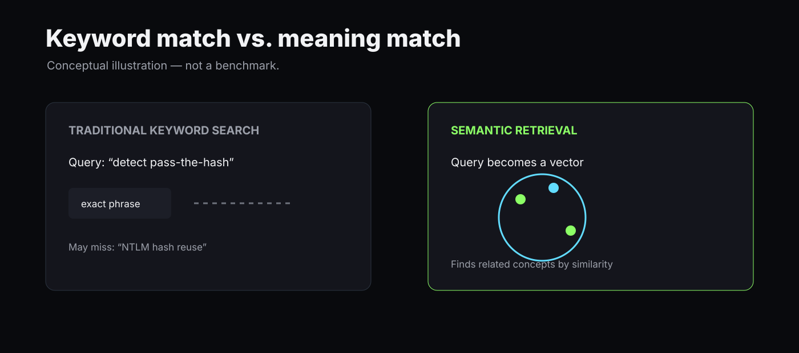

# Semantic search, visually

Keyword search asks whether the same words appear. Semantic retrieval embeds
the query and compares vector direction, so related wording can still surface
the right entry. The graphic uses fictional examples to explain the idea; its
positions and scores are not RIFT benchmarks.

1. Text is converted into a fixed-length vector.
2. RIFT normalizes the query vector.
3. FAISS compares it with the stored vectors.
4. Results below the configured threshold are omitted.

For the actual parameters and validation behavior, see
[HOW_IT_WORKS.md](../HOW_IT_WORKS.md) and
[USAGE_EXAMPLES.md](../USAGE_EXAMPLES.md).
