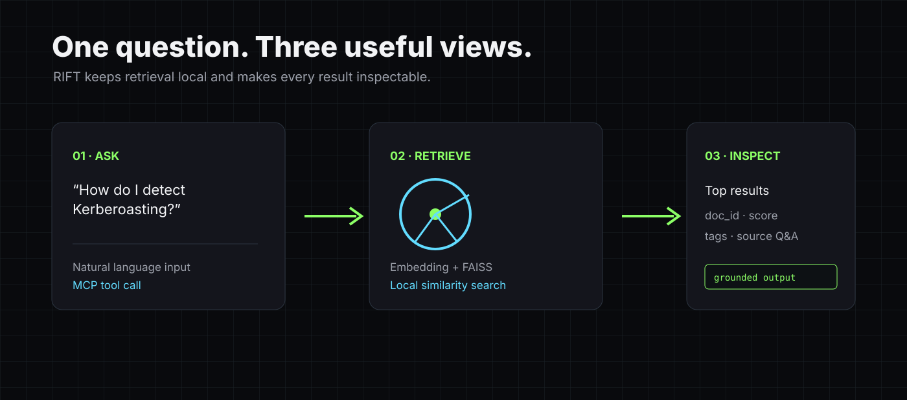

# What is RIFT?

RIFT is a local-first MCP server that retrieves relevant entries from a
curated offensive-security Q&A knowledge base. It returns stored questions and
answers with metadata and scores; it does not execute commands or invent an
attack plan.

## The visual in one minute

1. **Ask** a natural-language question from an MCP client.
2. **Retrieve** conceptually related entries with a local embedding model and
   FAISS `IndexFlatIP`.
3. **Inspect** the returned `doc_id`, score, tags, and source Q&A before acting.

The bundled index contains 23,737 aligned entries. Query-time retrieval can
run without a network connection after the model is cached.

**Try it:** [Getting started](../GETTING_STARTED.md) ·
[MCP contract](../MCP_INTEGRATION.md) · [Ethical use](../ETHICAL_USE.md)
